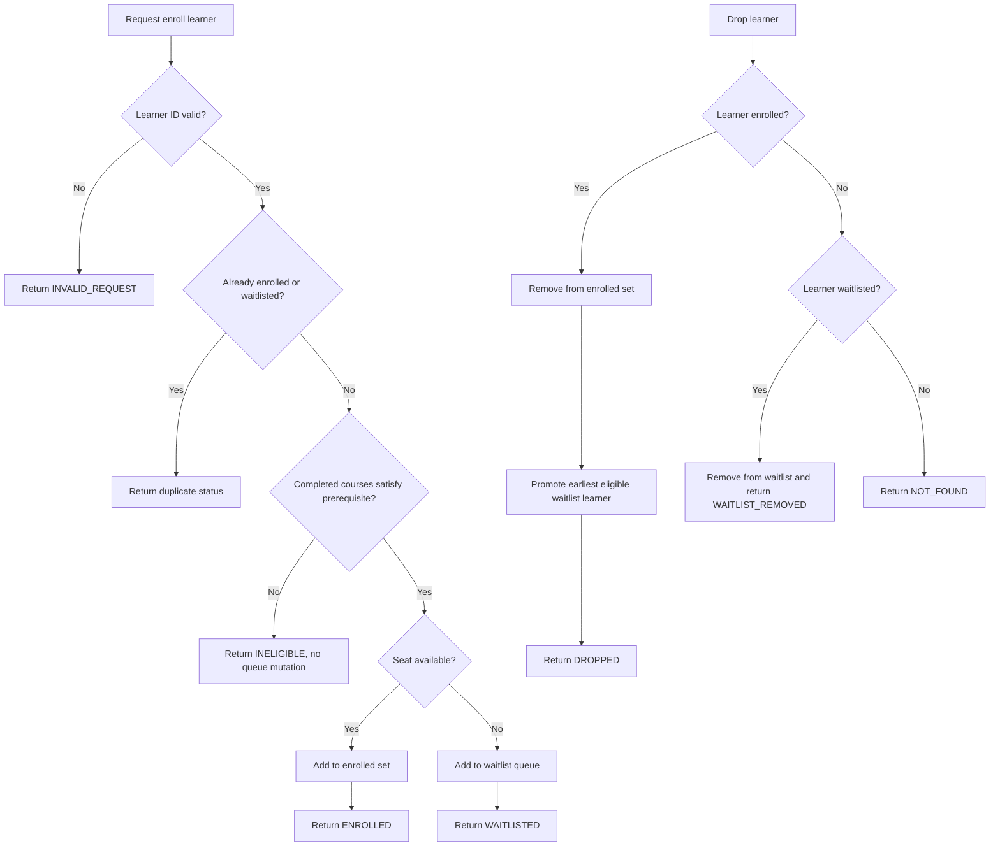

# Course Waitlist Design Specification

## 1. Scope

This service implements a single course offering's enrollment, drop, and waitlist-promotion behavior. It does not manage other course catalog, payment, identity, or multi-term concerns.

## 2. Service boundary

### Data/API

```text
CourseOffering
- courseId: String
- capacity: int
- prerequisiteCourseCode: String

CourseEnrollmentService
- enroll(learnerId, completedCourses)
- drop(learnerId)
- getEnrolledLearners()
- getWaitlist()
```

The service stores:

- `enrolledLearners`: a FIFO-preserving linked set of enrolled learner IDs
- `waitlist`: a linked queue of eligible learners waiting for a seat
- `waitlistedLearners`: membership set used to prevent duplicate waitlist entries
- `learnerCompletedCourses`: per-learner completed course snapshot for prerequisite checks

## 3. Business rules and assumptions

### Prerequisite assumption

A learner is eligible only if the supplied completed-course set contains the offering's configured prerequisite code. If the prerequisite is absent or blank, the service assumes no prerequisite is needed.

### Waitlist assumption

In this bounded service, an ineligible learner is rejected immediately and never enters the queue. This preserves queue integrity and avoids storing non-eligible learners in a FIFO queue. Queue membership is therefore limited to learners who were eligible at the time they requested enrollment.

### Promotion assumption

When a seat opens, the service scans the waitlist in FIFO order and promotes the first eligible learner. If the learner at the front of the queue is not eligible, they are not enrolled and the next candidate is not bypassed; the service keeps the queue unchanged until an eligible candidate reaches the front or an explicit drop removes a learner.

## 4. Capacity invariants

The service maintains these invariants:

- `enrolledLearners.size() <= course.capacity`
- a learner is enrolled at most once
- a learner is waitlisted at most once
- a learner is never simultaneously enrolled and waitlisted
- invalid or duplicate enrollment requests do not mutate state

## 5. Concurrency and persistence

This minimal starter is in-memory and uses a single `ReentrantLock` around state transitions. The lock protects the enrolled set, waitlist, and membership maps so concurrent enrollment and drop operations cannot overbook capacity or create duplicate entries.

This is suitable for a focused service slice. For a production-grade system, an external transaction store and queue/orchestration layer would be needed to handle multi-instance deployments.

## 6. Flow diagram



## 7. Scalability and tradeoffs

### Current solution

- Fast and deterministic for a single offering
- Easy to reason about and test
- Good for bounded feature work

### Tradeoff for scale

- In-memory state is not durable and does not survive process restarts.
- A single JVM lock is not enough for horizontally scaled service instances.
- As throughput grows, a transactional database plus one reliable queue for promotions would be the natural next step.

## 8. Key risks and follow-up

- The service assumes a single source of truth for learner completion data in the request itself.
- Because the feature scope is intentionally narrow, there is no retry, event-sourcing, or audit log layer yet.
- A production system would require stronger observability, dead-letter handling, and tenant/term isolation.
