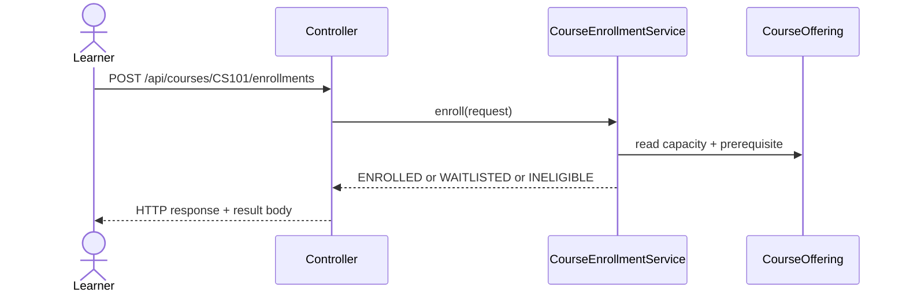

# User Workflows and Interactions

## 1. Learner enrollment flow

1. A learner submits a course enrollment request with a learner ID and a set of completed courses.
2. The controller validates the target course and passes the request to the service layer.
3. The service checks the learner state:
   - already enrolled -> return `ALREADY_ENROLLED`
   - already waitlisted -> return `ALREADY_WAITLISTED`
   - prerequisite missing -> return `INELIGIBLE`
4. If a seat is available, the learner is added to the enrolled set and the service returns `ENROLLED`.
5. If the course is full, the learner is added to the queue and the service returns `WAITLISTED`.

## 2. Drop and promotion flow

1. A learner or administrative actor issues a drop request.
2. The service checks whether the learner is currently enrolled.
3. If enrolled, the learner is removed from the enrolled set and the service scans the queue in FIFO order.
4. The first eligible learner is promoted; if none are eligible, the queue remains unchanged.
5. If the learner is only waitlisted, the service removes them from the waitlist without impacting current enrollment.
6. If the learner is absent from both states, the service returns `NOT_FOUND`.

## 3. Invalid request handling

- Missing learner ID -> `INVALID_REQUEST`
- Nonexistent course path -> HTTP 400 from the controller
- Duplicate operational requests -> clear duplicate status codes, no mutation

## 4. Operational interaction model

## 5. Design reasoning

The workflow is intentionally small and centered on one offering because the assignment scope is bounded. The controller is thin and delegates all business decisions to the service, which keeps the domain logic testable and mostly free from framework concerns. A single in-memory lock protects the service state so capacity, queue ordering, and duplicate checks remain consistent under concurrent requests.
